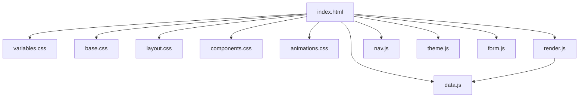
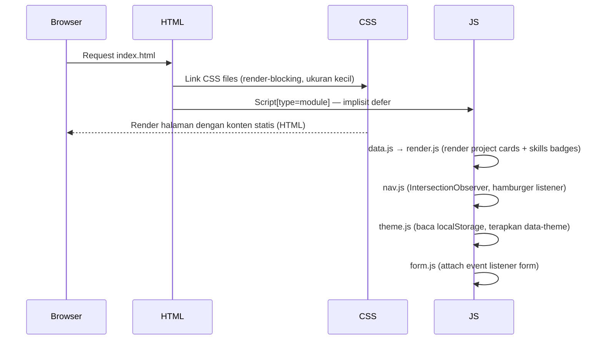

# Design Document

## Overview

Portfolio website statis satu halaman (*single-page*) milik Muhammad Ryan Hidayat, mahasiswa Teknik Informatika Universitas Bina Insani. Website dibangun dengan HTML5, CSS3, dan JavaScript vanilla — tanpa framework front-end, tanpa build tool wajib — sehingga dapat di-hosting langsung di GitHub Pages atau Netlify dengan mengunggah file statis.

**Tujuan utama:**
- Mempresentasikan profil profesional kepada rekruter, klien, maupun rekan kerja.
- Menampilkan portofolio proyek lengkap dengan tautan repositori/demo.
- Menyediakan saluran kontak langsung via formulir (Formspree) dan tautan profil eksternal.

**Prinsip desain:**
1. **Lightweight-first** — tidak ada CSS framework berat; semua gaya ditulis sebagai Custom Properties + minimal utility classes.
2. **Accessible by default** — semantik HTML5, rasio kontras WCAG AA, navigasi keyboard penuh.
3. **Progressive enhancement** — konten tersedia tanpa JavaScript; JavaScript hanya menambah interaksi.
4. **Single source of data** — konten dinamis (project cards, skills) didefinisikan sebagai array/object JS lalu di-render ke DOM, bukan dikodekan langsung di HTML.

---

## Architecture

### File Structure

```
revou-coding-camp/
├── index.html                # Satu-satunya halaman HTML
├── assets/
│   ├── css/
│   │   ├── variables.css     # CSS Custom Properties (tokens warna, ukuran, spacing)
│   │   ├── base.css          # Reset/normalize, tipografi global, utilitas
│   │   ├── layout.css        # Grid, breakpoint, container
│   │   ├── components.css    # Komponen: nav, card, badge, button, form
│   │   └── animations.css    # Keyframes, transition helpers, skeleton loader
│   ├── js/
│   │   ├── data.js           # Data proyek dan keahlian (array of objects)
│   │   ├── render.js         # Fungsi render DOM dari data.js
│   │   ├── nav.js            # Scroll-spy, hamburger toggle, smooth scroll
│   │   ├── theme.js          # Dark mode toggle, localStorage persistence
│   │   └── form.js           # Validasi & submit Contact_Form ke Formspree
│   ├── images/
│   │   ├── profile.webp      # Foto profil (1:1, ≥400×400 px sumber, ≤150 KB)
│   │   └── projects/         # Thumbnail proyek (WebP, ≤100 KB/gambar)
│   └── docs/
│       └── cv-ryan.pdf       # CV dalam format PDF
└── README.md
```

**Keputusan desain — tidak ada build step:** File CSS dimuat secara berurutan melalui `<link>` di `<head>`; file JS dimuat sebagai ES modules (`<script type="module">`). Tidak ada bundler (Webpack, Vite, dsb.) sehingga struktur file yang terlihat di repo identik dengan yang berjalan di browser.

### Module Dependency Graph



Semua modul JS dimuat dengan `<script type="module">` agar terisolasi. `data.js` adalah satu-satunya modul yang diimpor oleh `render.js`; modul lainnya tidak saling bergantung satu sama lain.

### Loading Sequence



CSS dimuat terlebih dahulu agar tidak terjadi *flash of unstyled content*. JS dijalankan setelah DOM tersedia (`type="module"` sudah implisit `defer`).

---

## Components and Interfaces

### Navigation

```
Desktop (≥768px):
┌──────────────────────────────────────────────────────────┐
│  Ryan·Hidayat        Home About Projects Skills Contact 🌙│
└──────────────────────────────────────────────────────────┘

Mobile (<768px) — menu tertutup:
┌───────────────────────┐
│  Ryan·Hidayat       ☰ │
└───────────────────────┘

Mobile (<768px) — menu terbuka:
┌───────────────────────┐
│  Ryan·Hidayat       ✕ │
│  Home                 │
│  About                │
│  Projects             │
│  Skills               │
│  Contact              │
└───────────────────────┘
```

- **Sticky positioning:** `position: sticky; top: 0; z-index: 1000` dengan `backdrop-filter: blur(8px)` agar konten di bawahnya tetap terbaca.
- **Active state:** tautan aktif mendapat class `.nav__link--active` (garis bawah + warna aksen). Hanya satu tautan aktif pada satu waktu.
- **ARIA:** `<button aria-expanded="false" aria-controls="nav-menu">` untuk hamburger; `<ul id="nav-menu">` untuk daftar tautan.

**API JavaScript (`nav.js`):**
```js
export function initNav()         // Setup scroll-spy + hamburger listener
// Internal:
function setActiveLink(id)        // Tambah/hapus class aktif berdasarkan section id
function toggleMenu()             // Buka/tutup menu mobile
function closeMenu()              // Tutup menu (dipanggil saat link diklik atau Escape)
function setupScrollSpy()         // IntersectionObserver per section
function setupKeyboardClose()     // Escape key menutup menu
function closeMenuOnLinkClick()   // Tutup menu saat tautan di-klik
```

### Hero Section

```
┌───────────────────────────────────────┐
│         [Foto profil 200×200]         │
│    Muhammad Ryan Hidayat              │
│    Tagline 1–2 kalimat (≤160 char)    │
│    [Lihat Proyek]                     │
│    [LinkedIn ↗]  [GitHub ↗]          │
└───────────────────────────────────────┘
```

- Foto profil berbentuk lingkaran (`border-radius: 50%`, `object-fit: cover`), `loading="eager"`.
- Tombol CTA "Lihat Proyek" memanggil `scrollIntoView({ behavior: 'smooth' })` ke `#projects`.
- Tautan LinkedIn dan GitHub: `target="_blank" rel="noopener noreferrer"`.

### About Section

```
┌───────────────────────────────────────┐
│  Tentang Saya                         │
│  [Paragraf 50–300 kata]               │
│  Universitas Bina Insani · Angkatan 2022 │
│  Minat: [teks tujuan karir]           │
│  [Unduh CV ↗]                         │
└───────────────────────────────────────┘
```

- Tombol "Unduh CV": anchor `href="assets/docs/cv-ryan.pdf" target="_blank"`.
- Jika file tidak ada (HTTP 404): event handler menonaktifkan tombol (`disabled`) dan menampilkan pesan inline `"CV tidak dapat dimuat saat ini."`.

### Project Card

```
┌──────────────────────────────────┐
│  [Thumbnail / skeleton loader]   │
│  Judul Proyek (≤60 char)         │
│  Deskripsi pendek (≤150 char)    │
│  [Tag1] [Tag2] [Tag3]            │
│  [GitHub ↗]  [Demo ↗]           │
└──────────────────────────────────┘
```

- Hover: `box-shadow` meningkat + `transform: translateY(-4px)`, `transition: all 150ms ease`.
- Tag: `<span class="badge">` dengan background aksen tipis.
- Jika tidak ada link: `<span class="no-link">Belum tersedia</span>`.
- Gambar menggunakan `loading="lazy"` dengan skeleton CSS sebagai placeholder.

### Skills Section

```
┌───────────────────────────────────────┐
│  Keahlian                             │
│  ── Bahasa Pemrograman ──             │
│  [Python] [JavaScript] [PHP] [Java]   │
│  ── Framework & Library ──            │
│  [Flask] [Bootstrap]                  │
│  ── Database ──                       │
│  [MySQL] [PostgreSQL]                 │
│  ── Tools & Platform ──               │
│  [Git] [VS Code] [GitHub]             │
│  ── Soft Skills ──                    │
│  [Komunikasi] [Kerja Tim]             │
└───────────────────────────────────────┘
```

- Setiap skill: `<span class="badge">` di dalam `<div class="skill-group">`.
- Setiap kategori memiliki `<h3>` sebagai heading.

### Contact Section

```
┌────────────────────────────────────────────────────┐
│  Hubungi Saya                                      │
│  Nama*  [________________________________]         │
│  Email* [________________________________]         │
│  Pesan* [________________________________]         │
│         [________________________________]         │
│         [Kirim Pesan]                              │
│  [status message area]                             │
│  ── Atau temukan saya di ──                        │
│  [LinkedIn ↗]  [GitHub ↗]  [email@domain.com]     │
└────────────────────────────────────────────────────┘
```

- Validasi sisi klien sebelum fetch ke Formspree.
- Pesan sukses/gagal ditampilkan inline di bawah tombol kirim (`role="alert"`).
- Kolom tetap terisi saat terjadi error pengiriman.
- Tautan email: `href="mailto:ryanhidayat@example.com"`.

### Footer

```
┌──────────────────────────────────────────────┐
│  © 2025 Muhammad Ryan Hidayat                │
│  Dibuat dengan HTML, CSS & JavaScript        │
└──────────────────────────────────────────────┘
```

Elemen `<footer>` semantik. Tidak ada JS yang diperlukan.

---

## Data Models

### Project

Didefinisikan di `assets/js/data.js` sebagai array of objects:

```js
/**
 * @typedef {Object} Project
 * @property {string}      id          - Slug unik, e.g. "todo-app"
 * @property {string}      title       - Maks. 60 karakter
 * @property {string}      description - Maks. 150 karakter
 * @property {string[]}    tags        - Maks. 8 item, masing-masing maks. 20 karakter
 * @property {string}      image       - Path relatif ke thumbnail
 * @property {string|null} repoUrl     - URL repositori atau null
 * @property {string|null} demoUrl     - URL demo atau null
 */

export const projects = [
  {
    id: "todo-app",
    title: "Todo App",
    description: "Aplikasi manajemen tugas berbasis web dengan fitur drag-and-drop.",
    tags: ["JavaScript", "CSS3", "HTML5"],
    image: "assets/images/projects/todo.webp",
    repoUrl: "https://github.com/ryanhidayat/todo-app",
    demoUrl: "https://ryanhidayat.github.io/todo-app"
  },
  // ... minimal 3 entries total
];
```

Constraint yang diterapkan saat runtime oleh `render.js`:
- `title.length <= 60`
- `description.length <= 150`
- `tags.length <= 8`, setiap tag `<= 20` karakter
- Jika `repoUrl === null && demoUrl === null`, tampilkan label "Belum tersedia"

### Skill

```js
/**
 * @typedef {Object} SkillCategory
 * @property {string}   category - Nama kategori, e.g. "Bahasa Pemrograman"
 * @property {string[]} items    - Daftar nama keahlian dalam kategori ini
 */

export const skills = [
  {
    category: "Bahasa Pemrograman",
    items: ["Python", "JavaScript", "PHP", "Java"]
  },
  {
    category: "Framework & Library",
    items: ["Flask", "Bootstrap"]
  },
  {
    category: "Database",
    items: ["MySQL", "PostgreSQL"]
  },
  {
    category: "Tools & Platform",
    items: ["Git", "VS Code", "GitHub"]
  },
  {
    category: "Soft Skills",
    items: ["Komunikasi", "Kerja Tim", "Problem Solving"]
  }
];
```

Setiap item hanya muncul dalam satu kategori (dijaga secara konvensi; data bersifat statis sehingga tidak diperlukan runtime enforcement).

### Theme State

```js
// Disimpan di localStorage, key: "portfolio-theme"
// Nilai valid: "light" | "dark"
// Prioritas pembacaan: localStorage → prefers-color-scheme → "light"
```

### Contact Form State

```js
// State form dikelola secara procedural di form.js
// Field: name (string ≤100), email (string ≤254), message (string ≤1000)
// Status lifecycle: "idle" → "submitting" → "success" | "error" → "idle"
```

---

## CSS Architecture

### CSS Custom Properties (Design Tokens)

Semua nilai desain didefinisikan di `variables.css` sebagai Custom Properties agar konsisten di seluruh file CSS dan mudah diubah tema:

```css
/* Light mode (default) */
:root {
  /* Warna */
  --color-bg:             #FFFFFF;
  --color-bg-surface:     #F5F7FA;
  --color-bg-elevated:    #EEF1F7;
  --color-text-primary:   #1A202C;
  --color-text-secondary: #4A5568;
  --color-text-muted:     #718096;
  --color-accent:         #3B82F6;   /* Blue 500 */
  --color-accent-hover:   #2563EB;   /* Blue 600 */
  --color-border:         #E2E8F0;
  --color-success:        #10B981;
  --color-error:          #EF4444;

  /* Tipografi */
  --font-sans: 'Inter', system-ui, -apple-system, sans-serif;
  --font-mono: 'Fira Code', 'Courier New', monospace;
  --text-xs:   0.75rem;    /* 12px */
  --text-sm:   0.875rem;   /* 14px */
  --text-base: 1rem;       /* 16px */
  --text-lg:   1.125rem;   /* 18px */
  --text-xl:   1.25rem;    /* 20px */
  --text-2xl:  1.5rem;     /* 24px */
  --text-3xl:  1.875rem;   /* 30px */
  --text-4xl:  2.25rem;    /* 36px */

  /* Spacing */
  --space-1:  0.25rem;
  --space-2:  0.5rem;
  --space-3:  0.75rem;
  --space-4:  1rem;
  --space-6:  1.5rem;
  --space-8:  2rem;
  --space-12: 3rem;
  --space-16: 4rem;
  --space-24: 6rem;

  /* Layout */
  --container-max:     1200px;
  --container-padding: var(--space-4);

  /* Radius */
  --radius-sm: 4px;
  --radius-md: 8px;
  --radius-lg: 16px;
  --radius-full: 9999px;

  /* Shadow */
  --shadow-sm: 0 1px 3px rgba(0,0,0,0.12);
  --shadow-md: 0 4px 12px rgba(0,0,0,0.15);
  --shadow-lg: 0 8px 24px rgba(0,0,0,0.18);
}

/* Dark mode — diaktifkan via data-theme="dark" pada <html> */
[data-theme="dark"] {
  --color-bg:             #0F172A;
  --color-bg-surface:     #1E293B;
  --color-bg-elevated:    #334155;
  --color-text-primary:   #F1F5F9;
  --color-text-secondary: #CBD5E1;
  --color-text-muted:     #94A3B8;
  --color-accent:         #60A5FA;   /* Blue 400 — lebih terang agar kontras di bg gelap */
  --color-accent-hover:   #93C5FD;
  --color-border:         #334155;
  --color-success:        #34D399;
  --color-error:          #F87171;
}
```

**Rasio kontras WCAG AA:**
- `--color-text-primary` pada `--color-bg` (light): ≈ 16:1 (melampaui AAA)
- `--color-text-secondary` pada `--color-bg` (light): ≈ 7:1 (melampaui AA)
- `--color-text-primary` pada `--color-bg` (dark): ≈ 15:1
- `--color-accent` pada `--color-bg` (light): ≈ 3.1:1 (memenuhi AA untuk UI/large text)

### Dark Mode Transition

```css
/* base.css — transisi halus saat tema berganti */
*, *::before, *::after {
  transition:
    background-color 200ms ease,
    color 200ms ease,
    border-color 200ms ease,
    box-shadow 200ms ease;
}
```

Ini memastikan perubahan tema berlangsung dalam ≤300ms sesuai Requirement 8.2. Transisi dinonaktifkan untuk elemen yang tidak memerlukan animasi (`@media (prefers-reduced-motion: reduce)`).

### Responsive Breakpoints

Strategi **mobile-first**: gaya default ditujukan untuk layar kecil; breakpoint menambahkan gaya untuk layar lebih besar.

| Breakpoint | Min Width | Layout Behavior |
|---|---|---|
| `mobile`  | 0px     | 1 kolom, hamburger nav |
| `tablet`  | 768px   | 2 kolom (Projects, Skills), nav tautan langsung |
| `desktop` | 1024px  | 3 kolom (Projects, Skills), layout penuh |
| `wide`    | 1280px  | Container max-width dikunci di 1200px |

```css
/* Contoh untuk Projects grid — layout.css */
.projects__grid {
  display: grid;
  grid-template-columns: 1fr;               /* mobile: 1 kolom */
  gap: var(--space-6);
}

@media (min-width: 768px) {
  .projects__grid {
    grid-template-columns: repeat(2, 1fr);  /* tablet: 2 kolom */
  }
}

@media (min-width: 1024px) {
  .projects__grid {
    grid-template-columns: repeat(3, 1fr);  /* desktop: 3 kolom */
  }
}

/* Skills menggunakan pola yang sama */
.skills__grid {
  display: grid;
  grid-template-columns: 1fr;
}

@media (min-width: 768px) {
  .skills__grid { grid-template-columns: repeat(2, 1fr); }
}

@media (min-width: 1024px) {
  .skills__grid { grid-template-columns: repeat(3, 1fr); }
}
```

---

## JavaScript Module Design

### `theme.js`

Bertanggung jawab: baca/tulis preferensi tema, terapkan ke `<html data-theme="">`.

```js
export function initTheme()   // Dipanggil saat DOMContentLoaded
export function toggleTheme() // Dipanggil oleh tombol toggle di nav

// Internal:
function applyTheme(theme)    // Set data-theme attribute + simpan ke localStorage
function detectPreference()   // Prioritas: localStorage → prefers-color-scheme → "light"
```

**Alur kerja:**
1. `initTheme()` membaca preferensi via `detectPreference()`.
2. Memanggil `applyTheme(theme)` yang meng-set `document.documentElement.setAttribute('data-theme', theme)`.
3. Tombol toggle di nav memanggil `toggleTheme()` yang membalik nilai dan memanggil `applyTheme()` lagi.

**localStorage fallback:** Jika `localStorage` tidak tersedia (private browsing, security restrictions), `detectPreference()` mengembalikan `"light"` tanpa throw error.

### `nav.js`

```js
export function initNav()
// Internal:
function setupScrollSpy()       // IntersectionObserver per section
function setActiveLink(id)      // Update class .nav__link--active
function setupHamburger()       // Click listener tombol hamburger
function setupKeyboardClose()   // Escape key menutup menu
function closeMenuOnLinkClick() // Tutup menu saat tautan di-klik
function toggleMenu()           // Buka/tutup menu mobile
function closeMenu()            // Tutup menu mobile
```

**Scroll-spy** menggunakan `IntersectionObserver` dengan `threshold: [0, 0.5]`:
- Observer mengamati setiap `<section>`.
- Saat ≥50% section masuk viewport, section tersebut dianggap aktif.
- Hanya satu tautan aktif pada satu waktu (tautan sebelumnya kehilangan class aktif).

**Smooth scroll:** `element.scrollIntoView({ behavior: 'smooth' })`. Durasi dikontrol browser (umumnya 300–600ms, dalam rentang Requirement 1.3).

**Hamburger focus management:**
- Saat menu terbuka: fokus diarahkan ke tautan pertama di menu.
- Saat menu ditutup: fokus dikembalikan ke tombol hamburger.

### `render.js`

```js
import { projects, skills } from './data.js';

export function renderProjects()          // Inject HTML ke #projects-grid
export function renderSkills()            // Inject HTML ke #skills-container

// Internal:
function createProjectCard(project)       // Kembalikan HTMLElement card
function createSkillGroup(group)          // Kembalikan HTMLElement group
function createBadge(text)               // Kembalikan <span class="badge">
function createImageWithSkeleton(src, alt) // Kembalikan  dengan skeleton loader
```

**Skeleton loader:** `createImageWithSkeleton` membungkus `` dalam `<div class="img-skeleton">`. Class `skeleton` pada div menampilkan animasi shimmer CSS. Ketika `img` memicu event `load`, class `skeleton` dihapus. Jika memicu event `error`, shimmer diganti placeholder error.

### `form.js`

```js
export function initContactForm()         // Attach semua event listener ke form

// Internal:
function validateName(value)             // Return { valid: bool, error: string }
function validateEmail(value)            // Return { valid: bool, error: string }
function validateMessage(value)          // Return { valid: bool, error: string }
function showFieldError(field, message)  // Tampilkan pesan error inline
function clearFieldError(field)          // Hapus pesan error
function showFormStatus(type, message)   // type: 'success' | 'error'
function submitToFormspree(data)         // fetch() POST ke Formspree endpoint
```

**Validasi email:** `validateEmail` memeriksa keberadaan karakter `@` yang diikuti minimal satu karakter, titik `.`, dan minimal satu karakter lagi (domain sederhana). Tidak menggunakan regex kompleks — hanya `value.includes('@')` dan pemeriksaan domain dasar — agar mudah dipahami dan diuji.

**Form submission flow:**
1. User klik "Kirim Pesan".
2. `validateName`, `validateEmail`, `validateMessage` dipanggil.
3. Jika ada error: `showFieldError` per field, tidak ada fetch.
4. Jika valid: tombol di-disable, status "submitting", `submitToFormspree(data)`.
5. Jika berhasil (HTTP 200): `showFormStatus('success', ...)`, form di-reset.
6. Jika gagal: `showFormStatus('error', ...)`, kolom tetap terisi, tombol di-enable kembali.

---

## Performance Strategy

| Strategi | Detail |
|---|---|
| Tanpa framework | Bundle JS akhir < 15 KB (uncompressed) |
| CSS modular | Tidak ada CSS framework besar; hanya custom properties + minimal utility |
| WebP untuk gambar | Thumbnail proyek ≤100 KB; foto profil ≤150 KB |
| `loading="lazy"` | Semua gambar di bawah fold; foto profil Hero menggunakan `loading="eager"` |
| `preconnect` ke Google Fonts | `<link rel="preconnect" href="https://fonts.googleapis.com">` |
| ES modules (`defer` implisit) | Semua `<script type="module">` tidak memblokir parsing HTML |
| Skeleton loader CSS | Shimmer animation via `@keyframes` tanpa library |
| Target LCP ≤ 2,5 detik | Foto profil eager-loaded + optimasi gambar + CSS kecil |

---

## Accessibility Approach

1. **Semantik HTML5:** Struktur halaman menggunakan `<header>`, `<nav>`, `<main>`, `<section>`, `<footer>`. Tepat satu `<main>` per halaman. Setiap `<section>` memiliki `aria-label`.
2. **Alt text:** Semua `` memiliki atribut `alt`. Gambar dekoratif: `alt=""`. Foto profil: `alt="Foto profil Muhammad Ryan Hidayat"`. Thumbnail proyek: `alt="[Judul proyek]"`. Panjang alt maksimal 150 karakter.
3. **ARIA hamburger:** `<button aria-expanded="false" aria-controls="nav-menu">` untuk tombol hamburger; `<ul id="nav-menu">` untuk daftar tautan.
4. **Focus management:** Saat menu terbuka → fokus ke tautan pertama. Saat menu ditutup → fokus kembali ke tombol hamburger.
5. **Tab order:** Elemen interaktif mengikuti urutan DOM yang logis; tidak ada `tabindex` positif.
6. **Tombol Escape:** Menutup hamburger menu jika terbuka (Requirement 9.5).
7. **Form labels:** Setiap `<input>` dan `<textarea>` memiliki `<label for="...">` eksplisit. Error messages memiliki `role="alert"`.
8. **Skip link:** `<a class="skip-link" href="#main">Lewati ke konten utama</a>` sebagai elemen pertama di `<body>`.
9. **Reduced motion:** `@media (prefers-reduced-motion: reduce)` menonaktifkan transisi tema dan animasi skeleton untuk pengguna yang membutuhkan.

---

## Error Handling

| Skenario | Perilaku |
|---|---|
| CV PDF tidak tersedia (404) | Tombol "Unduh CV" dinonaktifkan (`disabled`); pesan inline: "CV tidak dapat dimuat saat ini." |
| Pengiriman form ke Formspree gagal (HTTP ≠ 2xx atau network error) | Pesan error inline di bawah form dengan `role="alert"`; semua field tetap terisi |
| Validasi form gagal (field kosong, email invalid) | Pesan error spesifik per field; form tidak dikirim ke Formspree |
| Gambar proyek gagal dimuat | Placeholder error: ikon broken image + teks nama proyek |
| Font Google gagal dimuat | Fallback ke `system-ui` via CSS font stack |
| `localStorage` tidak tersedia | Tema default "light" digunakan; tidak ada error thrown |

---

## Correctness Properties

*A property is a characteristic or behavior that should hold true across all valid executions of a system — essentially, a formal statement about what the system should do. Properties serve as the bridge between human-readable specifications and machine-verifiable correctness guarantees.*

### Property 1: Active Navigation Link — Exactly One Active at a Time

*For any* valid section ID (`"hero"`, `"about"`, `"projects"`, `"skills"`, `"contact"`), after calling `setActiveLink(id)`, exactly one navigation link in the navigation bar SHALL have the active CSS class, and it SHALL be the link whose `href` attribute corresponds to that section ID.

**Validates: Requirements 1.4**

### Property 2: Hamburger Menu Toggle Is a Round-Trip (Idempotent in Pairs)

*For any* initial state of the navigation menu (open or closed), calling `toggleMenu()` twice in succession SHALL return the menu to its original state — the `aria-expanded` attribute and the visibility class on the menu element SHALL be identical to their values before the two calls.

**Validates: Requirements 1.6**

### Property 3: Any Nav Link Click Closes the Mobile Menu

*For any* navigation link element contained within the mobile menu, simulating a click on that link while the menu is open SHALL result in the navigation menu being closed (`aria-expanded = "false"` and menu visibility class removed), regardless of which specific link is clicked.

**Validates: Requirements 1.7**

### Property 4: Project Card Renders All Required Fields Correctly

*For any* valid `Project` object (title ≤ 60 chars, description ≤ 150 chars, tags array ≤ 8 items each ≤ 20 chars), `createProjectCard(project)` SHALL return an HTML element that:
- contains the project title text,
- contains the project description text,
- contains a badge element for each tag in `project.tags`,
- if `repoUrl` is non-null, contains an anchor with `href === repoUrl` and `target === "_blank"`,
- if `demoUrl` is non-null, contains an anchor with `href === demoUrl` and `target === "_blank"`,
- if both `repoUrl` and `demoUrl` are null, contains a text label indicating no link is available.

**Validates: Requirements 4.2, 4.4, 4.5, 4.7**

### Property 5: Skills Rendering Preserves All Items Exactly Once Per Category

*For any* valid `skills` array (array of `{category: string, items: string[]}`), `renderSkills(skills)` SHALL produce a DOM fragment where:
- each category name appears as a heading element exactly once,
- each skill item text appears within a badge element exactly once across all categories (no duplicates, no omissions),
- each skill item is nested within the DOM subtree of its corresponding category heading.

**Validates: Requirements 5.1, 5.2**

### Property 6: Contact Form Validation Rejects All Invalid Inputs Without Sending

*For any* combination of input values where at least one of the following conditions holds:
- the name field is empty or composed entirely of whitespace characters, OR
- the email field does not contain the character `@` followed by at least one character and a `.` and at least one character after it (no valid domain), OR
- the message field is empty or composed entirely of whitespace characters,

the form validation SHALL return an error result for each offending field, and no network request SHALL be made to the Formspree endpoint.

**Validates: Requirements 6.4**

### Property 7: Theme Preference Persists Across Re-Detection (localStorage Round-Trip)

*For any* theme value in `{"light", "dark"}`, after `applyTheme(theme)` stores the value in `localStorage`, a subsequent call to `detectPreference()` SHALL return that same theme value, regardless of the operating system's `prefers-color-scheme` media query setting at the time of the call.

**Validates: Requirements 8.3**

---

## Testing Strategy

### Dual Testing Approach

Both unit/example tests and property-based tests are used together for comprehensive coverage. Unit tests verify specific scenarios and integration points; property tests verify universal invariants across a large input space.

### Property-Based Testing Library

**[fast-check](https://github.com/dubzzz/fast-check)** (JavaScript) — chosen because it is mature, actively maintained, and integrates well with Jest/Vitest.

**Configuration:** Minimum **100 iterations** per property test (`numRuns: 100`).

**Tag format:** Each property test includes a comment:
```js
// Feature: portfolio-website, Property N: <property_text>
```

### Unit Tests (JavaScript Logic)

Fokus pada fungsi murni yang tidak bergantung DOM browser:

| Fungsi | Test Type | Deskripsi |
|---|---|---|
| `validateEmail(value)` | Property + Example | Format email valid untuk berbagai input string |
| `validateName(value)` | Property + Example | Panjang nama 1–100 karakter, tolak whitespace-only |
| `validateMessage(value)` | Property + Example | Panjang pesan 1–1000 karakter, tolak whitespace-only |
| `detectPreference()` | Example | Urutan prioritas: localStorage → prefers-color-scheme → "light" |
| `createProjectCard(project)` | Property | Output HTML mengandung semua field yang diperlukan |
| `renderSkills(skills)` | Property | Output HTML mengandung semua kategori dan item skill |
| `setActiveLink(id)` | Property | Tepat satu link aktif setelah dipanggil |
| `toggleMenu()` x2 | Property | Menu kembali ke state awal setelah dua kali toggle |

### Property Tests

Setiap correctness property di atas diimplementasikan sebagai satu property-based test dengan fast-check:

```js
// Contoh implementasi Property 7:
// Feature: portfolio-website, Property 7: Theme preference persists across re-detection
import fc from 'fast-check';
import { applyTheme, detectPreference } from './theme.js';

test('theme localStorage round-trip', () => {
  fc.assert(
    fc.property(
      fc.oneof(fc.constant('light'), fc.constant('dark')),
      (theme) => {
        applyTheme(theme);
        // Mock prefers-color-scheme to opposite value
        const result = detectPreference();
        return result === theme;
      }
    ),
    { numRuns: 100 }
  );
});
```

### Integration Tests

Dilakukan manual atau dengan Playwright (minimal):
- Form submission ke Formspree (1–2 contoh): verifikasi respons sukses dan pesan konfirmasi.
- Dark mode persistence: refresh halaman → tema yang tersimpan diterapkan.
- Scroll-spy: scroll ke setiap section → tautan navigasi yang sesuai aktif.
- CV download: klik tombol → file PDF terbuka di tab baru.

### Accessibility Tests

- **axe-core** via browser extension untuk audit otomatis WCAG AA.
- Navigasi keyboard manual: Tab (urutan fokus), Enter (aktivasi elemen), Escape (tutup hamburger).
- Lighthouse audit: Performance ≥ 90, Accessibility ≥ 90 pada simulasi 4G throttling.
